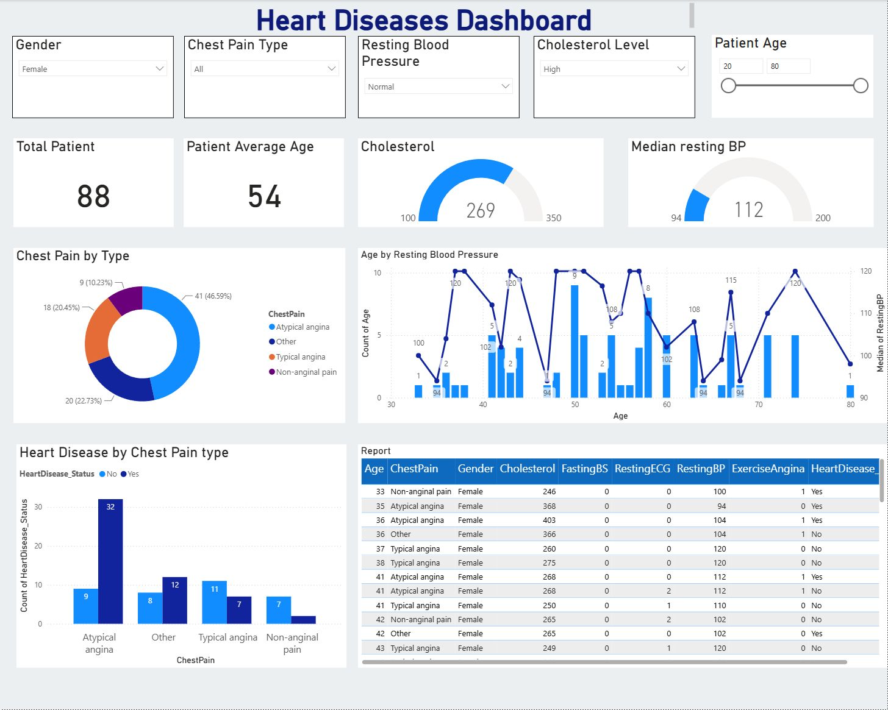

# Heart Disease Data Exploration in Power BI

**Start here:** [Original PBIX](Heart%20Disease%20Model.pbix) → [data verification status](#dataset-verification-status) → [next checks](#next-verification-steps)

[Available artefact](#available-artifact) · [Dataset status](#dataset-verification-status) · [Scope](#scope-and-limitations) · [Next steps](#next-verification-steps)

An earlier educational Power BI project exploring the distribution of recorded demographic attributes, measurements and heart-disease labels. This is a dashboard exercise, not a validated clinical tool.

## Visual evidence

Actual Power BI Desktop review screenshot. Filters: Female; chest pain All; resting-BP category Normal; cholesterol category High; age 20–80. The gauge now uses median instead of summed resting BP. Imported values, source units, category rules and dataset provenance remain unverified; this is not clinical evidence.

Images are static previews. Open them at full size for detail; follow the reproduction notes to inspect the underlying work.

## Available artifact

[Download the original Power BI file](Heart%20Disease%20Model.pbix). Open it in Power BI Desktop to inspect its model, measures and visuals. The PBIX is preserved unchanged; it was opened in Power BI Desktop without refreshing its source. A [separate local review copy](Heart%20Disease%20Model-reviewed-20261030.pbix) corrects the resting-BP gauge from Sum to Median and labels it accordingly. This is a scoped repair, not validation of the dataset or all measures.

## Appropriate analytical questions

- How are the recorded attributes distributed in this particular dataset?
- How do counts and label proportions differ across documented groups?
- Which missing values, duplicate records or coding choices could affect those comparisons?

These are questions for further verification, not claims of measured findings. No numerical result is presented without a reproducible underlying calculation.

## Dataset verification status

The earlier documentation attributed the data to UCI and stated 2,943 records. The raw dataset and an exact download reference are not included in this repository, so that attribution, row count and preprocessing history have not been independently verified. They should be confirmed from the PBIX source connection and a data dictionary before being reported as facts.

## Scope and limitations

This project does not establish diagnosis, treatment effectiveness, disease progression, mortality, personalized treatment plans or real-time monitoring. A descriptive dashboard cannot establish those capabilities from cross-sectional attribute comparisons. Associations in a sample must not be described as clinical predictors without an appropriate validated analysis.

This documentation revision removes unsupported capability claims from the previous README. It does not certify the original model, source data, cleaning steps or visual calculations.

## Next verification steps

1. Recover the exact source dataset and document its publisher, version and licence.
2. Reconcile raw and imported record counts; document missing values and duplicates.
3. Define each displayed metric and validate its DAX against an independent calculation.
4. Complete the measure/source checks before reporting descriptive findings. A real screenshot of the scoped local repair is included above, with its filter context and limitations.

Until those checks are complete, the hotel, energy and churn case studies on [my profile](https://github.com/Kelv-Ojo) provide more reproducible examples of my portfolio work. This project description was revised with AI assistance.

## Portfolio review notes

This is an artefact-first project awaiting source and metric verification. Do not state the old row count or UCI attribution as verified without the exact input data. Recover the source connection and licence, reconcile imported rows and DAX, and complete the review of the now-captured populated dashboard. Keep it as descriptive educational reporting; it is not a diagnostic or treatment system.
